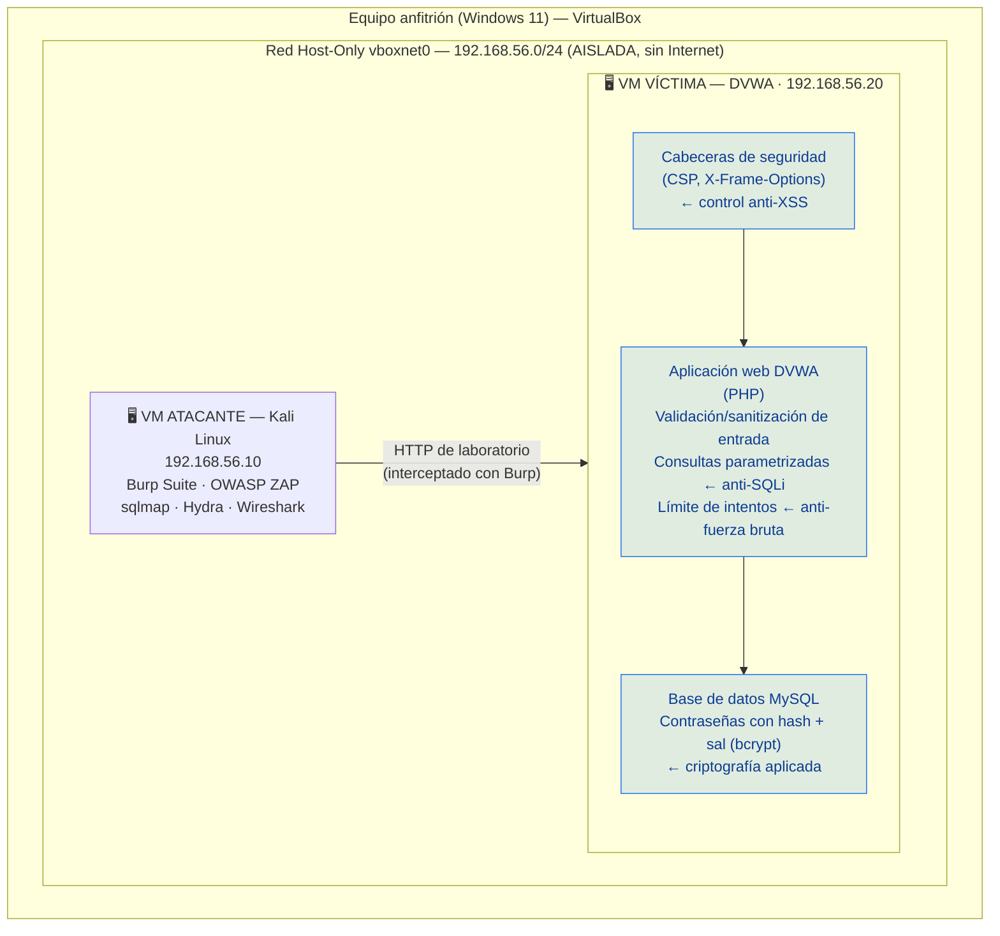

# Artefacto 1 — Diagrama de arquitectura segura

Muestra las máquinas virtuales, la red aislada y **dónde vive cada control** de
seguridad (los controles van en el estado *mitigado* del laboratorio).

> Pega este diagrama en draw.io o visualízalo con cualquier visor de Mermaid.
> Para el documento final, expórtalo como imagen a `evidencias/`.

## Lectura del diagrama

- **Todo ocurre dentro del equipo anfitrión**, en una red Host-Only que no sale
  a Internet ni toca la red real.
- La **VM atacante (Kali)** envía las peticiones de prueba y las intercepta con
  Burp Suite / ZAP.
- La **VM víctima (DVWA)** es el objetivo deliberadamente vulnerable. Sobre ella
  colocamos los controles en la fase de mitigación:
  - **Cabeceras de seguridad** (capa del servidor web) → mitigan **XSS**.
  - **Validación de entrada + consultas parametrizadas** (capa de aplicación) →
    mitigan **Inyección SQL**.
  - **Límite de intentos / bloqueo** (capa de aplicación) → mitiga **fuerza bruta**.
  - **Hash con sal (bcrypt)** en la base de datos → protege las credenciales aun
    si la BD se ve comprometida (**criptografía aplicada**).

## Nota sobre la arquitectura (estado vulnerable vs. mitigado)

En la fase 1 (ataque) la VM víctima corre **sin** estos controles (DVWA en nivel
*Low*). En la fase 2 (mitigación) activamos los controles (DVWA en nivel *High*
y/o cambios de configuración) y repetimos los ataques para demostrar que ya no
funcionan. Ese par **antes → después** es el corazón de la evidencia.
