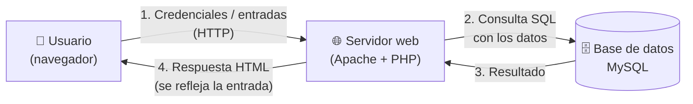

# Artefacto 2 — Flujo de datos e identificación de amenazas (STRIDE)

Describe por dónde viajan los datos y qué los amenaza en cada punto. Usamos
**STRIDE** como checklist para no dejar amenazas por fuera.

## Flujo de datos (caso: login y formularios de la web)

Puntos sensibles numerados:

1. **Entrada del usuario → servidor:** el atacante puede inyectar payloads
   (SQLi, XSS) o automatizar intentos de login (fuerza bruta).
2. **Servidor → base de datos:** si la entrada se concatena en la consulta, hay
   **Inyección SQL**.
3. **Base de datos:** si las contraseñas están en texto plano, un volcado de la
   BD las expone todas.
4. **Respuesta → navegador:** si la entrada se devuelve sin sanitizar, se
   ejecuta **XSS** en el navegador de la víctima.

## Checklist STRIDE

| Categoría STRIDE | ¿Aplica aquí? | Amenaza concreta en el caso | Punto del flujo |
|---|---|---|---|
| **S**poofing (suplantación) | Sí | Adivinar/robar credenciales por **fuerza bruta** en el login | 1 |
| **T**ampering (manipulación) | Sí | **Inyección SQL** para alterar/leer datos que no corresponden | 1 → 2 |
| **R**epudiation (repudio) | Parcial | Falta de registro de intentos de login impide auditar quién atacó | 1 |
| **I**nformation disclosure (fuga) | Sí | Volcado de BD con contraseñas en texto plano; **XSS** roba cookies de sesión | 3, 4 |
| **D**enial of service (DoS) | Fuera de alcance | No se simulan ataques de disponibilidad en este TCC | — |
| **E**levation of privilege (escalada) | Sí | SQLi que permite autenticarse como `admin`; XSS que secuestra sesión admin | 2, 4 |

> **Alcance:** este proyecto se concentra en **S, T, I y E** a través de tres
> vectores (XSS, SQLi, fuerza bruta). El DoS queda **fuera de alcance** por ser
> un enfoque distinto (ataques de red) y por la regla de no degradar servicios.

## De las amenazas a los controles

Cada amenaza marcada "Sí" se cierra con un control. El detalle está en el
Artefacto 3 (`03-controles.md`).
